# 🛡️ Awesome Threat Intelligence

<p align="center">
  
</p>

<p align="center">
  <a href="https://github.com/ishandutta2007/Awesome-Awesome-Awesome"></a>
  <a href="https://discord.gg/jc4xtF58Ve"></a>
  <a href="https://github.com/ishandutta2007/Awesome-Threat-Intelligence/stargazers"></a>
  <a href="https://github.com/ishandutta2007/Awesome-Threat-Intelligence/network/members"></a>
  <a href="https://github.com/ishandutta2007/Awesome-Threat-Intelligence/blob/main/LICENSE"></a>
  <a href="https://github.com/ishandutta2007/Awesome-Threat-Intelligence/issues"></a>
  <a href="https://github.com/ishandutta2007/Awesome-Threat-Intelligence/pulls"></a>
  <a href="https://github.com/ishandutta2007"></a>
</p>

---

## 🧭 Executive Summary & SEO Overview

**Awesome Threat Intelligence** is a definitive, community-curated catalog of enterprise **SaaS platforms**, **cyber threat intelligence (CTI) platforms (TIP)**, and battle-tested **open-source tools**. Designed for security operations center (SOC) analysts, threat hunters, incident responders, CERTs/CIRTs, and cybersecurity researchers, this repository tracks modern solutions to collect, correlate, enrich, and operationalize adversary telemetry.

Key operational focus areas include:
* **Indicators of Compromise (IOCs)**: Hashes, malicious IPs, phishing domains, and C2 infrastructure.
* **Tactics, Techniques, and Procedures (TTPs)**: Real-time adversary tracking mapped to the **MITRE ATT&CK®** and **D3FEND** frameworks.
* **Standardized Formats**: Deep support for **STIX 2.1**, **TAXII**, **MISP standard**, and **YARA/Sigma** detection rules.
* **Open Source Intelligence (OSINT)** & **Dark Web Monitoring**: Proactive exposure management, compromised credential alerts, and underground criminal forum telemetry.

---

## 📑 Table of Contents

- [📊 Sector Overview & Market Dynamics](#-sector-overview--market-dynamics)
- [🏢 SaaS & Hosted Commercial Platforms](#-saas--hosted-commercial-platforms)
- [🔓 Open-Source GitHub Projects (Sorted by Stars)](#-open-source-github-projects-sorted-by-stars)
- [🧩 Architecture Blueprint: Building a Sovereign CTI Stack](#-architecture-blueprint-building-a-sovereign-cti-stack)
- [🎯 Threat Intelligence Standards & Formats](#-threat-intelligence-standards--formats)
- [🤝 How to Contribute](#-how-to-contribute)
- [💖 Support & Community](#-support--community)
- [📈 Star History](#-star-history)
- [📜 Disclaimer](#-disclaimer)

---

## 📊 Sector Overview & Market Dynamics

The global **Cyber Threat Intelligence (CTI)** market is undergoing exponential expansion, driven by intensifying geopolitical state-sponsored cyber warfare, ransomware-as-a-service (RaaS) operations, and AI-orchestrated attack vectors.

* **Estimated Market Size**: The global CTI industry was valued at approximately **$11.6 Billion in 2024–2025** and is projected to reach **$23.5+ Billion by 2030**, advancing at a Compound Annual Growth Rate (CAGR) of **15.2% to 17.8%**. Increasing regulatory pressure (such as NIS2 in the EU, SEC cyber incident disclosure rules in the US, and DORA for financial services) mandates continuous, actionable threat landscape visibility.
* **Market Structure & Fragmentation**: The sector is **moderately fragmented**. Rather than a single "winner-take-all" monopoly, market share is distributed across two primary layers:
  1. *Ecosystem Hyperscalers & Enterprise XDR/SIEM Leaders* (Alphabet/Google Mandiant, Cisco Talos, ServiceNow, Palo Alto Networks Unit 42, and CrowdStrike) who monetize planetary-scale proprietary telemetry, endpoint data, and incident response engagements.
  2. *Dedicated Pure-Play Threat Intelligence Platforms (TIPs) & Niche Reconnaissance Specialists* (Recorded Future, Anomali, ThreatConnect, Flashpoint, and Cyware) that excel in deep dark web actor engagement, specialized vulnerability intelligence (VulnDB), and federated multi-vendor STIX/TAXII orchestration.
* Modern enterprise SOC teams rarely rely on a single vendor; instead, they adopt a **hybrid multi-feed aggregation model**, fusing commercial feeds with sovereign, self-hosted open-source stacks (such as MISP and OpenCTI).

---

## 🏢 SaaS & Hosted Commercial Platforms

The following enterprise platforms provide commercial threat feeds, adversary attribution, AI-driven correlation, and dedicated analyst access. Entries are **sorted descending by company size / market valuation**.

| 🏢 Platform & Vendor | 🌐 Company Size / Valuation | 🎯 Key Capabilities & Core Focus | 💵 Starting Pricing | 🎁 Free Tier & Trial Limits |
| :--- | :--- | :--- | :--- | :--- |
| **[Mandiant Threat Intelligence](https://www.mandiant.com/)**<br>*(Google Cloud / Alphabet)* | **$2.1T+ Valuation**<br>*(Alphabet Market Cap; acquired Mandiant for $5.4B; Google Cloud ~$40B+ ARR)* | Frontline incident response telemetry, nation-state APT group tracking, vulnerability exploit intelligence, and finished analyst intelligence reports. | **$45,000 / year**<br>*(Entry Mandiant Advantage tier; enterprise contracts average ~$83,000/yr; GUS per-GB cloud options)* | **Mandiant Advantage Free Community Tier**<br>*(Permanent free access to basic known threat actor profiles, daily news, and MITRE ATT&CK pivot views)*; or 30-day Google Cloud PoC evaluation with $300 trial credits. |
| **[Cisco Talos](https://talosintelligence.com/)**<br>*(Cisco Systems)* | **$220B+ Valuation**<br>*(Cisco Systems Market Cap; ~$54B annual revenue)* | World's largest commercial telemetry grid (1.5M+ malicious samples daily, 550B+ security events daily), Talos Incident Response retainer, Snort/ClamAV signatures. | **$32.40 / user / year**<br>*($2.70/user/month via Cisco Umbrella DNS Security embedding Talos; Talos IR retainer starts at $25,000/yr)* | **14-day full free trial** on Cisco Umbrella (up to 1,000 users with full Talos threat blocking); permanent free public web reputation lookup on talosintelligence.com for IPs, domains, and hashes. |
| **[ServiceNow Threat Intelligence](https://www.servicenow.com/)**<br>*(ServiceNow)* | **$190B+ Valuation**<br>*(ServiceNow Market Cap; ~$11B annual revenue)* | Threat Intelligence Security Center native to Now Platform SecOps; correlates IOCs with CMDB enterprise context, automated risk scoring, and threat playbooks. | **$1,800 / fulfiller / year**<br>*($150/fulfiller/month for SecOps fulfiller seat; foundational SecOps enterprise module bundles start at ~$40,000/year)* | **ServiceNow Personal Developer Instance (PDI)**<br>*(100% free full sandbox instance with SecOps and Threat Intelligence plugins enabled; active permanently as long as renewed every 10 days)*. |
| **[Palo Alto Networks Unit 42](https://unit42.paloaltonetworks.com/)**<br>*(Palo Alto Networks)* | **$115B+ Valuation**<br>*(Palo Alto Networks Market Cap; ~$8.6B annual revenue)* | Unit 42 elite adversary intelligence, Cortex eXtended Threat Intelligence (XTI), Continuous Frontier AI Defense, Threat Intelligence Management (TIM), and native XSOAR playbooks. | **$50,000 / year**<br>*(Cortex XSOAR / Threat Intelligence Management base enterprise package; or $3,500/firewall gateway for Cloud-Delivered SecOps feeds)* | **Cortex XSOAR Community Edition**<br>*(30-day full-featured free trial, automatically converts into permanent free tier capped at 166 automated commands/day, 30 days incident retention, and limited active feeds)*. |
| **[CrowdStrike Falcon Intelligence](https://www.crowdstrike.com/)**<br>*(CrowdStrike)* | **$80B+ Valuation**<br>*(CrowdStrike Market Cap; ~$3.9B annual revenue)* | Global tracking of 280+ adversary groups, real-time IOCs, automated sandbox detonation, pre-built YARA/Snort signatures, and Falcon Charlotte AI hunting agents. | **$59.99 / device / year**<br>*($4.99/device/month on Falcon Go; Falcon Enterprise with built-in threat intel starts at $184.99/device/yr; standalone Falcon Adversary Intel starts at $15,000/yr)* | **15-day free trial**<br>*(Up to 100 endpoints, includes Falcon Prevent NGAV and threat telemetry; instant activation without requiring a credit card)*. |
| **[Recorded Future](https://www.recordedfuture.com/)**<br>*(Mastercard)* | **$2.65B Valuation**<br>*(Acquired by Mastercard for $2.65B; Recorded Future ARR ~$300M+; Mastercard Market Cap ~$460B)* | AI-powered Intelligence Cloud processing open/dark web, technical telemetry, MITRE ATT&CK mapping for 350+ malware families, real-time risk scores for billions of entities. | **$40,000 – $60,000 / year**<br>*(Core single-module entry deployment with unlimited users within the organization; mid-market bundles average ~$100,000/year)* | **Recorded Future Express** browser extension<br>*(Permanent free real-time risk scores and IOC lookups for IPs, domains, hashes, and CVEs)*; 30-day free trial for Splunk and Microsoft Sentinel integrations. |
| **[Anomali ThreatStream](https://www.anomali.com/)**<br>*(Anomali)* | **~$700M Valuation**<br>*(Series E funded by Google Ventures, IVP, General Catalyst; ~$65M ARR)* | Big-data Threat Intelligence Platform (TIP), ThreatStream Analytics with AQL language, automated IOC deduplication and enrichment, bi-directional integration with SIEM/EDR. | **$90,000 / year**<br>*(ThreatStream Enterprise base deployment for up to 5 analysts and core feed connectors; scales with telemetry volume)* | **30-day enterprise Proof-of-Concept (PoC)** evaluation via sales<br>*(Provides full access to ThreatStream platform, curated threat feeds, and sandbox detonation for up to 5 security analysts)*. |
| **[ThreatConnect TI Ops](https://threatconnect.com/)**<br>*(ThreatConnect)* | **~$450M Valuation**<br>*(Acquired/backed by Elephant Partners; ~$50M ARR)* | Threat Intelligence Operations (TI Ops) combining TIP and SOAR, CAL (Collective Analytics Library) automated threat scoring, AI report parsing, MITRE ATT&CK correlation. | **$60,000 / year**<br>*(Entry-level TI Ops cloud subscription including core threat repository and basic automation playbooks)* | **30-day proof-of-concept (PoC) evaluation**<br>*(Full access to TI Ops platform, STIX/TAXII feed ingestion, and up to 5 analyst seats during PoV evaluation)*. |
| **[Flashpoint Ignite](https://flashpoint.io/)**<br>*(Flashpoint)* | **~$400M Valuation**<br>*(Backed by Audax Private Equity; ~$60M annual revenue)* | Primary-source human and technical dark web intelligence, illicit forum monitoring, VulnDB enhanced vulnerability intelligence, credential leak detection, managed attribution browsing. | **£12,150 (~$15,500) / user / year**<br>*(Ignite platform license via UK G-Cloud framework; mid-market enterprise bundles start at ~$115,500/year)* | **21-day (3-week) to 30-day guided enterprise trial**<br>*(Access to Flashpoint Ignite platform, search queries, and VulnDB vulnerability repository with dedicated analyst support)*. |
| **[Cyware Intelligence Suite](https://www.cyware.com/)**<br>*(Cyware)* | **~$300M Valuation**<br>*(Series C funded by Ten Eleven Ventures, Prelude, Advent; ~$35M ARR)* | Cyware Intel Exchange (CTIX) cyber threat intelligence platform, automated STIX/TAXII 2.1 bi-directional sharing across ISACs/CERTs, automated enrichment, integrated sandbox. | **$45,000 / year**<br>*(Cyware Intel Exchange [CTIX] entry-tier deployment with standard threat connectors and automated deduplication)* | **14-day to 30-day guided Proof of Concept (PoC)**<br>*(Sandbox environment configured with up to 3 live threat feeds and STIX 2.1 exchange testing)*. |

---

## 🔓 Open-Source GitHub Projects (Sorted by Stars)

The open-source CTI ecosystem provides complete data sovereignty, community-validated schemas, and vendor-neutral pipelines. Below is an exhaustive collection of leading open-source threat intelligence tools, **strictly sorted descending by GitHub Stars_Count**.

---

### 1. [SpiderFoot](https://github.com/smicallef/spiderfoot) [](https://github.com/smicallef/spiderfoot/stargazers)
* **Category**: Automated OSINT & Attack Surface Discovery | **License**: MIT
* **Description**: High-performance OSINT automation tool with 200+ modular plugins. Queries IP addresses, domain names, e-mail addresses, subnets, ASN, and Bitcoin addresses across Shodan, VirusTotal, Censys, and dark web indexes to map target attack surfaces and reconnaissance footprints.

### 2. [Sigma](https://github.com/SigmaHQ/sigma) [](https://github.com/SigmaHQ/sigma/stargazers)
* **Category**: Generic Threat Detection Signatures | **License**: Detection Rules / Tooling
* **Description**: The industry standard for expressing threat detection rules in a vendor-agnostic YAML format. Facilitates rapid translation of adversary TTPs and intelligence advisories into targeted queries for Splunk, Elastic, Microsoft Sentinel, QRadar, and CrowdStrike Falcon.

### 3. [OpenCTI](https://github.com/OpenCTI-Platform/opencti) [](https://github.com/OpenCTI-Platform/opencti/stargazers)
* **Category**: Comprehensive Threat Intelligence Platform (TIP) | **License**: Apache-2.0
* **Description**: Enterprise-grade, STIX 2.1-native cyber threat intelligence platform built with GraphQL, Node.js, and Python. Structures adversary profiles, malware families, campaigns, and indicators into a dynamic knowledge graph with extensive connectors to MISP, MITRE ATT&CK, and SIEM/EDR platforms.

### 4. [YARA](https://github.com/VirusTotal/yara) [](https://github.com/VirusTotal/yara/stargazers)
* **Category**: Malware Identification & Pattern Matching | **License**: BSD-3-Clause
* **Description**: The de-facto pattern-matching tool for malware researchers and threat intelligence analysts. Allows security teams to identify, classify, and rule-hunt binary artifacts, malicious code families, and suspicious memory artifacts across endpoints and sandboxes.

### 5. [T-Pot](https://github.com/telekom-security/tpotce) [](https://github.com/telekom-security/tpotce/stargazers)
* **Category**: Multi-Honeypot Platform & Telemetry Collector | **License**: GPL-3.0
* **Description**: All-in-one, multi-architecture honeypot platform running on Debian GNU/Linux and Docker. Aggregates honeypots (Cowrie, Dionaea, Honeytrap, Conpot) with the Elastic Stack to harvest empirical, real-world attacker telemetry, zero-day exploit attempts, and active brute-force IPs.

### 6. [Maltrail](https://github.com/stamparm/maltrail) [](https://github.com/stamparm/maltrail/stargazers)
* **Category**: Malicious Traffic Detection & IOC Correlator | **License**: GPL-2.0
* **Description**: Lightweight network traffic analysis system designed to detect malicious requests, command-and-control (C2) communication, and spyware activity by comparing live packet captures against blacklists and curated threat feeds.

### 7. [DeepDarkCTI](https://github.com/fastfire/deepdarkCTI) [](https://github.com/fastfire/deepdarkCTI/stargazers)
* **Category**: Dark Web OSINT & Ransomware Group Tracking | **License**: Community List
* **Description**: Authoritative repository aggregating dark web (.onion), clear web, and Telegram channels utilized by active cybercriminal groups, ransomware syndicates, leak sites, and data brokers for threat intelligence research.

### 8. [Cowrie](https://github.com/micheloosterhof/cowrie) [](https://github.com/micheloosterhof/cowrie/stargazers)
* **Category**: Medium & High Interaction SSH/Telnet Honeypot | **License**: BSD-3-Clause
* **Description**: Emulates an SSH and Telnet server to log brute-force attacks and capture the entire shell interaction performed by adversaries. Produces invaluable empirical threat intelligence including stolen credentials, downloaded malware payloads, and attacker commands.

### 9. [MISP](https://github.com/MISP/MISP) [](https://github.com/MISP/MISP/stargazers)
* **Category**: Threat Sharing & IOC Management Platform | **License**: AGPL-3.0
* **Description**: The gold-standard open-source platform for sharing, storing, and correlating threat intelligence indicators of compromise (IOCs). Enables automated synchronization between CERTs, ISACs, military units, and corporate SOCs with full support for STIX/TAXII and TLP markings.

### 10. [IntelOwl](https://github.com/intelowlproject/IntelOwl) [](https://github.com/intelowlproject/IntelOwl/stargazers)
* **Category**: Observable Enrichment & Triage Automation | **License**: AGPL-3.0
* **Description**: Fast threat intelligence orchestration engine that ingests observables (IPs, domains, hashes, URLs) and queries 100+ public and commercial analyzers (VirusTotal, AbuseIPDB, GreyNoise, Shodan) concurrently in seconds via a modern Django/React architecture.

### 11. [TheHive](https://github.com/TheHive-Project/TheHive) [](https://github.com/TheHive-Project/TheHive/stargazers)
* **Category**: Security Incident Response & Case Management | **License**: AGPL-3.0
* **Description**: Scalable Security Incident Response Platform (SIRP) closely interconnected with MISP. Enables analysts to collaborate on security incidents, track observables, investigate task timelines, and trigger automated analytical playbooks.

### 12. [MITRE ATT&CK CTI](https://github.com/mitre/cti) [](https://github.com/mitre/cti/stargazers)
* **Category**: Canonical CTI Knowledge Base in STIX 2.1 | **License**: MITRE Terms
* **Description**: Official repository containing the MITRE ATT&CK® enterprise, mobile, and ICS matrices expressed natively in STIX 2.1 format. Essential foundational dataset for mapping adversary groups (APT28, FIN7, etc.), software tools, and mitigation matrices.

### 13. [Yeti](https://github.com/yeti-platform/yeti) [](https://github.com/yeti-platform/yeti/stargazers)
* **Category**: Threat Data Hub & Graph Analysis | **License**: Apache-2.0
* **Description**: Unified threat repository organizing observables, indicators, TTPs, and malware campaigns. Features automated ingestion pipelines from security blogs, RSS feeds, and sandboxes, paired with an intuitive graph correlation UI and REST API.

### 14. [Cortex](https://github.com/TheHive-Project/Cortex) [](https://github.com/TheHive-Project/Cortex/stargazers)
* **Category**: Observable Analysis & Active Response Engine | **License**: AGPL-3.0
* **Description**: Companion execution engine for TheHive and MISP. Executes observable analysis via 100+ automated analyzers (domain reputation, malware sandboxing, IP geo-location) and triggers active response responders with a single click.

### 15. [Viper](https://github.com/botherder/viper) [](https://github.com/botherder/viper/stargazers)
* **Category**: Binary Analysis & Malware Intelligence Organizer | **License**: BSD-3-Clause
* **Description**: Specialized binary management and analysis framework. Functions like a "metasploit for malware analysis", indexing sample hashes, extractable strings, PE headers, and YARA rules to maintain a local repository of malicious artifacts.

### 16. [AIL Framework](https://github.com/CIRCL/AIL-framework) [](https://github.com/CIRCL/AIL-framework/stargazers)
* **Category**: Information Leak & Dark Web Scraper | **License**: AGPL-3.0
* **Description**: Developed by CIRCL (Computer Incident Response Center Luxembourg), AIL is a modular platform to analyze unstructured information streams (Pastebin, Telegram, dark web forums, Tor hidden services) to uncover data leaks and credential dumps.

### 17. [Harpoon](https://github.com/Te-k/harpoon) [](https://github.com/Te-k/harpoon/stargazers)
* **Category**: Threat Hunting & OSINT CLI Suite | **License**: GPL-3.0
* **Description**: Comprehensive CLI toolkit for threat analysts. Unifies queries across 40+ threat platforms (PassiveTotal, Shodan, Censys, VirusTotal, SecurityTrails, AlienVault OTX) directly from terminal pipelines.

### 18. [IntelMQ](https://github.com/certtools/intelmq) [](https://github.com/certtools/intelmq/stargazers)
* **Category**: Automated Feed Processing Pipeline | **License**: AGPL-3.0
* **Description**: Modular solution developed by European CERTs for security teams to collect and process hundreds of heterogeneous threat intelligence feeds. Features a robust bot architecture for parsing, harmonizing, and dispatching alerts to SIEMs.

### 19. [ThreatIngestor](https://github.com/InQuest/ThreatIngestor) [](https://github.com/InQuest/ThreatIngestor/stargazers)
* **Category**: Unstructured CTI Extraction & Normalization | **License**: MIT
* **Description**: Extracts IOCs and threat context from unstructured text sources including Twitter/X accounts, RSS feeds, PDFs, and arbitrary web pages. Emits standardized artifacts directly into MISP, OpenCTI, or local files.

### 20. [PyMISP](https://github.com/MISP/PyMISP) [](https://github.com/MISP/PyMISP/stargazers)
* **Category**: MISP API Python SDK | **License**: BSD-2-Clause
* **Description**: Official Python library to interact with MISP platforms. Provides complete programmatic capability to search, add, update, and manage IOC events, sightings, tags, and warning lists.

### 21. [cti-python-stix2](https://github.com/oasis-open/cti-python-stix2) [](https://github.com/oasis-open/cti-python-stix2/stargazers)
* **Category**: OASIS STIX 2.0 & 2.1 Python APIs | **License**: BSD-3-Clause
* **Description**: Official OASIS Python APIs for serializing, parsing, and validating STIX 2.0 and STIX 2.1 cybersecurity threat intelligence objects and bundles.

---

## 🧩 Architecture Blueprint: Building a Sovereign CTI Stack

For security teams seeking full data privacy without per-seat or per-feed SaaS lock-in, the open-source ecosystem provides a comprehensive, interconnected architecture:

```
                  +----------------------------------------------+
                  |            Threat Ingestion Layer            |
                  |  [SpiderFoot] [ThreatIngestor] [IntelMQ]     |
                  |     - OSINT Feeds, RSS, AbuseIPDB, Tor       |
                  +-----------------------+----------------------+
                                          |
                                          v
                  +----------------------------------------------+
                  |         Correlation & Analysis Engine        |
                  |        [MISP] <=======> [OpenCTI]            |
                  |  - STIX 2.1 Knowledge Graph & IOC Storage    |
                  |  - MITRE ATT&CK Mapping & Deduplication      |
                  +-----------------------+----------------------+
                                          |
                                          v
                  +----------------------------------------------+
                  |          Enrichment & Active Triage          |
                  |          [IntelOwl] + [Cortex]               |
                  |  - 100+ Multi-API Observable Analyzers       |
                  |  - YARA Pattern Hunting & Hash Lookup        |
                  +-----------------------+----------------------+
                                          |
                                          v
                  +----------------------------------------------+
                  |         Action & Incident Response           |
                  |           [TheHive] / SIEM / SOAR            |
                  |  - SOC Ticket Resolution & Firewall Blocks   |
                  |  - Sigma Rule Deployment into Production     |
                  +----------------------------------------------+
```

---

## 🎯 Threat Intelligence Standards & Formats

* **STIX™ (Structured Threat Information Expression)**: Standard language created by OASIS for communicating cyber threat information in JSON. Covers Threat Actors, Attack Patterns, Malware, Campaigns, and Indicators.
* **TAXII™ (Trusted Automated eXchange of Intelligence Information)**: Application protocol designed to exchange STIX intelligence over HTTPS.
* **TLP (Traffic Light Protocol)**: Standard color coding (TLP:RED, TLP:AMBER+STRICT, TLP:AMBER, TLP:GREEN, TLP:CLEAR) indicating the distribution boundary for threat findings.
* **MITRE ATT&CK®**: Curated knowledge base of cyber adversary behavior, documenting specific tactical phases and verifiable techniques.
* **Sigma**: Generic, readable YAML format for expressing detection rules across disparate SIEM and log analytics architectures.
* **YARA**: Multi-platform rule language enabling analysts to identify and classify malware samples matching textual or binary patterns.

---

## 🤝 How to Contribute

Contributions are warmly encouraged! Help expand the threat intelligence community resource:

1. **Fork this repository** on GitHub.
2. **Add or refine an entry** in `README.md` respecting alphabetical or numerical sort rules.
3. **Include factual verification**: Product name, official URL, exact starting pricing, precise free tier/trial specifications, and company valuation data.
4. **Submit a Pull Request** with a concise summary of the addition or revision.

---

## 💖 Support & Community

Thank you for visiting **Awesome Threat Intelligence**! If this curated repository aids your threat operations, SOC enrichment, or adversary tracking workflows:

* ⭐ **Star this repository** to help other security researchers discover it.
* 🍴 **Fork it** to maintain custom organizational playbooks.
* 📢 **Share it** across your security network (LinkedIn, X, Discord, Reddit).
* ☕ **Support the maintainer**: Buy a coffee and support continuous updates on our [GitHub Sponsors Dashboard](https://github.com/sponsors/ishandutta2007).

<p align="center">
  <a href="https://github.com/sponsors/ishandutta2007">
    
  </a>
</p>

---

## 📈 Star History

[](https://star-history.dera.page/#ishandutta2007/Awesome-Threat-Intelligence&type=date&legend=top-left)

---

## 📜 Disclaimer

* This repository is a community-curated directory intended solely for defensive cybersecurity research, educational initiatives, and SOC operations.
* Always adhere to legal, regulatory, and ethical guidelines when conducting OSINT, threat reconnaissance, and dark web research.
* Verify commercial licenses before deploying open-source components in production environments (e.g., AGPL-3.0, Apache-2.0, MIT, BSD).
* All product names, logos, and brands are property of their respective owners.
